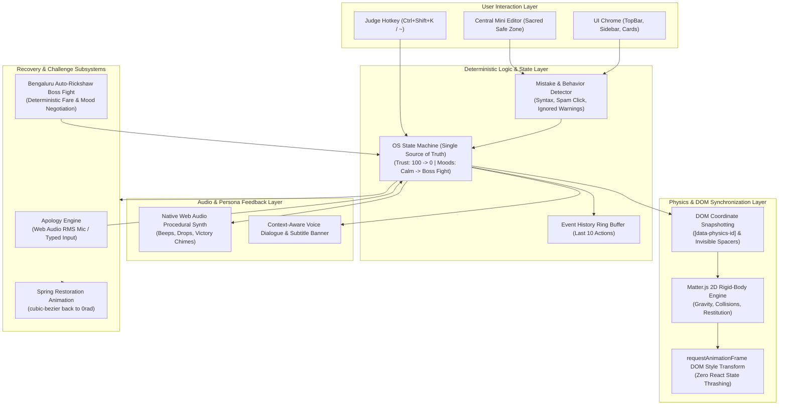

# Namma Fragile OS (SynapseX / Sorry.exe) — Technical Architecture

> **Tagline:** "An operating system that remembers every mistake. Unfortunately, it takes them personally."  
> **Target:** CodeDay Bengaluru Hackathon  
> **Core Guarantee:** 100% Client-Side Determinism (Zero LLM / Zero External Server Dependencies at Runtime).

---

## 1. System Architecture Overview

The system is designed with a unidirectional state and event architecture. User interactions pass through the **Mistake & Behavior Detector**, which dispatches events to the central **OS State Machine**. State changes drive the **UI Renderer**, the **Matter.js Physics Bridge**, the **Sound Synthesis & Voice Engine**, and the **Recovery Modals**.



---

## 2. Core State Machine Specification (`src/app/osStateMachine.js`)

The state machine is the single source of truth for the entire application.

### 2.1 State Schema
```typescript
interface OSState {
  trust: number;                     // 0 to 100 (initial: 100)
  mood: OSMood;                      // Enum below
  mistakeCount: number;              // Cumulative syntax / validation errors
  ignoredWarnings: number;           // Dismissed toasts without code edits
  rapidClickEvents: number;          // Rapid clicking incidents (>= 4 clicks / 1.5s)
  apologyAttempts: number;           // Number of apologies attempted
  eventHistory: Array<OSEvent>;      // Last 10 user events for dialogue callbacks
  isCollapsed: boolean;              // True when Matter.js owns chrome elements
  isRecovering: boolean;             // True when restoration animation is running
}

type OSMood = 
  | 'CALM'                 // Trust: 80–100
  | 'SLIGHTLY_ANNOYED'     // Trust: 60–79
  | 'PERSONAL_BETRAYAL'    // Trust: 35–59
  | 'MENTAL_BREAKDOWN'     // Trust: 1–34
  | 'BENGALURU_BOSS_FIGHT' // Trust: 0
  | 'RECOVERY';            // During UI reassembly
```

### 2.2 Mood Thresholds & UI Reactions
| Mood | Trust Range | UI Visual State | Audio / SFX | Dialog Tone |
| :--- | :---: | :--- | :--- | :--- |
| **CALM** | 80–100 | Clean Linear/VS Code slate dark mode (`#0B0F19`). Emerald status indicator. | Subtle keypress clicks | Professional, proud tech assistant. |
| **SLIGHTLY_ANNOYED** | 60–79 | Amber accent shifts. Toast sighs. CSS keyframe tremor (`rotate(-1deg)`). | Gentle low sigh / soft blip | "Ayyo, one bracket missing. Let's not start the day like this." |
| **PERSONAL_BETRAYAL** | 35–59 | Crimson borders (`#EF4444`). Buttons jitter off-axis. Warning banners flicker. | Discordant minor chord, warning chime | "You dismissed my warning and did the exact same thing. Koramangala founder behavior." |
| **MENTAL_BREAKDOWN** | 1–34 | **Physics Collapse:** TopBar, Sidebar, Status cards detach and fall under gravity. | Descending pitch whistle, metal clatter | "I am not crashing. I am emotionally unavailable. Fix your attitude." |
| **BENGALURU_BOSS_FIGHT** | 0 | Workspace locked. Sacred editor shielded. Bengaluru Auto CAPTCHA modal appears. | Horn honk, rain sound, engine rev | "Meter haakamma! Indiranagar 450 rupees. Take it or walk." |
| **RECOVERY** | Post-Challenge | Spring reassembly animation (`transform 0.7s cubic-bezier`). Trust resets to 85. | 8-bit victory arpeggio, clean chime | "Fine. I'll restore the toolbar. Trust is still loading." |

---

## 3. Non-Negotiable Physics & DOM Synchronization (`PhysicsWorld.js`)

To prevent the classic bug where React re-renders battle Matter.js physics:

### 3.1 Sacred Safe Zone vs. Collapsible Chrome
- **Sacred Safe Zone (NEVER detaches):**
  - Central Mini Code Editor (`MiniEditor.jsx`)
  - User-typed code buffer
  - Recovery Modal (`RecoveryModal.jsx`) & Auto Negotiation Modal (`AutoNegotiation.jsx`)
  - Reset Demo & Emergency Controls
- **Collapsible Chrome (Tagged with `data-physics-id`):**
  - Top navigation bar & breadcrumbs
  - Sidebar icons & tool buttons
  - Status/Telemetry cards & integrity meters
  - Floating toast notifications

### 3.2 The Snapshot-and-Spacer Pattern
1. **Detection:** When `trust <= 34` or on Emergency Chaos trigger, query all `[data-physics-id]` elements.
2. **Snapshotting:** Run `getBoundingClientRect()` on each element, recording:
   $$\{ x: \text{rect.left} + \frac{\text{width}}{2}, \ y: \text{rect.top} + \frac{\text{height}}{2}, \ \text{width}, \ \text{height} \}$$
3. **Invisible Spacers:** Instantly inject a placeholder element with `visibility: hidden; width: rect.width; height: rect.height` into the React layout tree. This guarantees the Central Code Editor **does not shift or reflow by even 1 pixel**.
4. **Matter.js Body Generation:**
   - Create rigid-body rectangles with restitution (`0.4`), friction (`0.1`), and density (`0.001`).
   - Add static boundary walls for the viewport bottom, left, and right (with bottom offset above the status bar).
   - Apply a randomized horizontal impulse ($\pm 0.02$) and angular velocity ($\pm 0.05\text{ rad/s}$) so pieces tumble realistically.
5. **Direct RAF Synchronization (Zero React Rerenders):**
   - In an active `requestAnimationFrame` loop, read Matter.js body coordinates and update DOM node styles directly:
     ```javascript
     node.style.transform = `translate3d(${body.position.x - width / 2}px, ${body.position.y - height / 2}px, 0) rotate(${body.angle}rad)`;
     ```
6. **Smooth Spring Restoration:**
   - On recovery: stop Matter.js runner, remove physics bodies.
   - Set `node.style.transition = 'transform 0.7s cubic-bezier(0.22, 1, 0.36, 1)'`.
   - Animate `style.transform` back to cached origin `(0, 0, 0rad)`.
   - Remove inline styles, remove invisible spacers, and return layout control to standard React/CSS.

---

## 4. Deterministic Mistake & Behavior Detection Engine (`mistakeDetector.js`)

All checks execute locally with zero external network or parser dependencies:

1. **Syntax Checking (Deliberate JavaScript checks):**
   - Unbalanced brackets check: `()`, `{}`, `[]`.
   - Missing semicolon on variable declarations (`const`, `let`).
   - Deprecated syntax: Typing `var ` triggers immediate irritation penalty.
2. **Rapid Click / Spam Detector:**
   - Tracks button clicks in a sliding 1500ms window. If click count $\ge 4$, increments `rapidClickEvents` and cuts trust by 15.
3. **Ignored Warning Detector:**
   - If user dismisses a warning toast and clicks "Run Code" without modifying the text buffer, marks `ignoredWarnings += 1` (punished twice as heavily: $-25$ trust).
4. **Forbidden Button:**
   - Red `"Do Not Touch (Prod DB)"` button in the sidebar. Clicking it immediately cuts trust by 40 points with a dramatic alarm.

---

## 5. Procedural Web Audio Engine & Subtitles (`AudioManager.js`)

### 5.1 Dual Audio Layer (Zero Asset Failure Risk)
- **Layer A (Procedural Synthesis via Web Audio API):**
  - Generates tones using `OscillatorNode` + `GainNode`:
    - Keystroke clicks: 800Hz sine ping (15ms decay).
    - Annoyance sigh: Low-pass filtered pink/brown noise burst.
    - Falling UI: Descending sine wave ($600\text{Hz} \rightarrow 80\text{Hz}$).
    - Clatter: Rapid noise bursts on Matter.js collision events.
    - Victory chime: Major arpeggio ($C_5 - E_5 - G_5 - C_6$).
- **Layer B (Pre-recorded / Synthesized Voice Clips):**
  - Played via HTML5 Audio with user-gesture unlock.
- **Layer C (Persistent High-Contrast Subtitle Pill):**
  - Fixed bottom-center high-z-index pill.
  - Typewriter text animation + emotional avatar expression indicator.
  - Ensures the joke lands 100% even in a deafening hackathon hall or if the judge's laptop is muted.

---

## 6. Recovery Subsystems

### 6.1 Spoken Apology vs. Typed Apology
- **Microphone Route (Web Audio `AnalyserNode`):**
  - User holds "Speak Apology" button.
  - Samples RMS (Root Mean Square) volume level over 1.5 seconds.
  - If average amplitude $> 0.15$ threshold, counts as an emotional apology.
  - Fully optional: Mic permission errors cleanly fall back to typed input.
- **Typed Apology Route:**
  - Sincerity validation: Must contain keywords (`"sorry"`, `"apologize"`, `"anna"`, `"mistake"`).
  - Length check: $\ge 15$ characters (or $\ge 30$ characters if `ignoredWarnings > 1`).

### 6.2 The Bengaluru Auto-Rickshaw Boss Fight (`AutoNegotiation.jsx`)
A deterministic state-machine negotiation mini-game:
- **Scenario:** It is 6:30 PM, raining, and you need an auto from Koramangala to Indiranagar.
- **Initial State:** `driverMood = 'REFUSING'`, `currentFare = 450`.
- **Dialogue Tree:**
  - *Option A:* "Anna, meter haaki." $\rightarrow$ Driver: "Meter? Naanu developer alla, auto driver! 500." (Mood decreases).
  - *Option B:* "Anna, meter mele 50 extra kodthini." $\rightarrow$ Driver softens: "Sari, baa. But cash only." (Success!).
  - *Option C:* "Ola is showing 180." $\rightarrow$ Driver: "Haagaadre Ola-llene hogu!" (Immediate rejection, retry).
  - *Option D:* "I am late for CodeDay pitch." $\rightarrow$ Driver: "CodeDay-na? Indiranagar 100ft road traffic nodidya? 300 final." (Negotiable).
- Winning the negotiation restores trust and initiates workspace reassembly.

---

## 7. Hackathon Judge Speedrun & Demo Controls

To ensure smooth 60–90 second presentations during lightning rounds:
- **Emergency Chaos Hotkey:** `Ctrl + Shift + K` or `~` (tilde) or double-clicking the Mascot avatar instantly triggers maximum meltdown.
- **Reset Demo Button:** Fixed emerald "Reset Demo" button in the TopBar and recovery screens for instant full restoration without page refresh.
- **Preset Trigger Pills:** Small test buttons at the bottom of the editor:
  - `[Inject Missing Bracket]`
  - `[Spam Click Simulator]`
  - `[Ignore Warning]`
  - `[Touch Prod DB]`

---

## 8. Directory & File Structure

```
c:\Users\sagar\Projects\CodeDay-Blr\
├── package.json
├── vite.config.js
├── tailwind.config.js
├── index.html
├── AGENTS.md                   # Operational rules for coding assistants
├── ARCHITECTURE.md             # This document (system design spec)
├── Docs\
│   └── Namma Fragile OS.md     # Original PRD & Product direction
└── src\
    ├── main.jsx                # React root mount
    ├── index.css               # Tailwind & custom tremor keyframes
    ├── app\
    │   ├── App.jsx             # Main desktop container & hotkey listeners
    │   ├── osStateMachine.js   # Single source of truth (trust, mood, events)
    │   └── demoPresets.js      # Judge speedrun & sample broken code snippets
    ├── components\
    │   ├── TopBar.jsx          # Window controls, breadcrumbs, Reset button
    │   ├── Sidebar.jsx         # Tool icons + "Do Not Touch" prod DB button
    │   ├── MiniEditor.jsx      # Sacred Safe Zone: line numbers, code editor, Run button
    │   ├── StatusPanel.jsx     # Trust meter, irritability gauge, event log HUD
    │   ├── SubtitleBanner.jsx  # High-contrast bottom subtitle pill & mascot
    │   ├── RecoveryModal.jsx   # Apology route (Web Audio RMS + text)
    │   └── AutoNegotiation.jsx # Bengaluru Auto Boss Fight mini-game
    ├── physics\
    │   ├── PhysicsWorld.js     # Matter.js world runner, walls, snapshot manager
    │   └── springAnimator.js   # Cubic-bezier reassembly coordinator
    ├── audio\
    │   ├── AudioManager.js     # Audio controller & voice line sequencer
    │   ├── soundSynthesizer.js # Web Audio API procedural oscillator effects
    │   └── voiceLines.js       # Scripted Kannada/Hinglish dialog library
    └── logic\
        ├── mistakeDetector.js  # Deterministic syntax & spam rules
        └── negotiationTree.js  # Auto-rickshaw dialogue state graph
```

